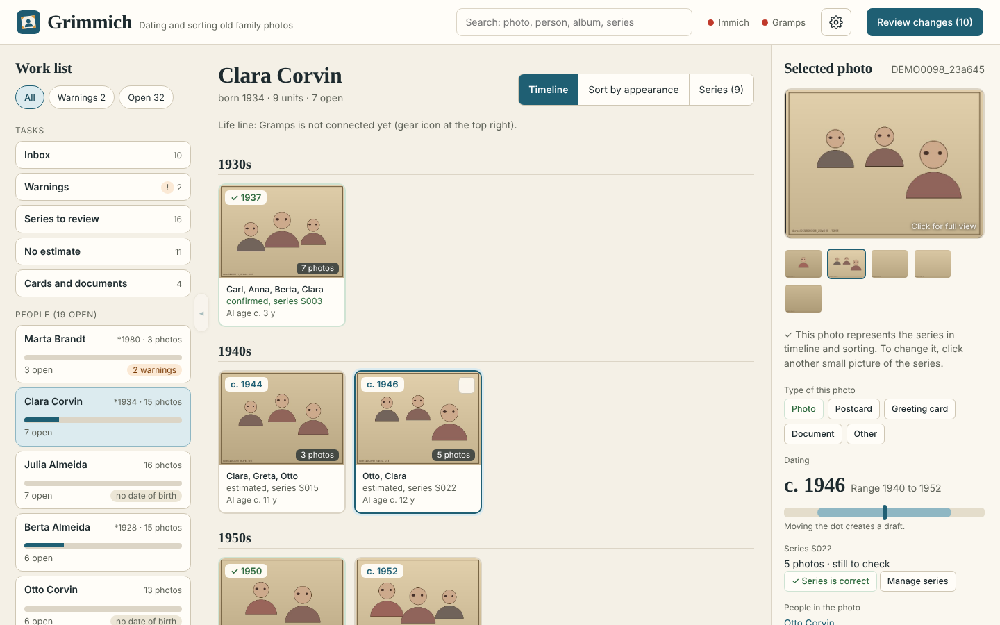
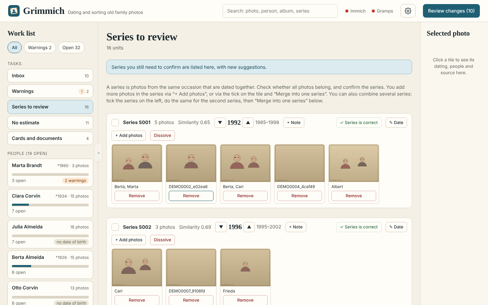
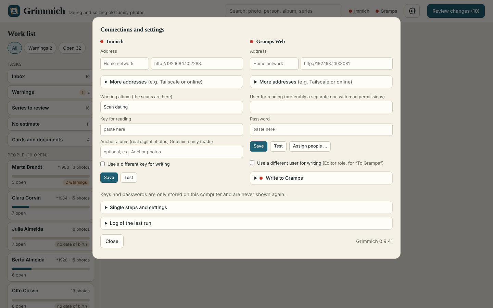

# Grimmich

[English](README.md) · **Deutsch**

Grimmich datiert eingescannte Altfotos. Es liest die Fotos und Gesichter aus [Immich](https://immich.app),
schätzt mit einer KI das Alter der erkannten Personen, rechnet mit den Lebensdaten aus [Gramps Web](https://gramps-project.org)
auf ein Aufnahmejahr, fasst zusammengehörige Fotos zu Serien zusammen und schreibt das Ergebnis zurück
(Aufnahmedatum und Tags in Immich, Fotos, Quellen und Ereignisse in Gramps).
Alles läuft auf deinem eigenen Rechner. In Immich und Gramps wird nur geschrieben, wenn du es in der Oberfläche
ausdrücklich bestätigst (Vorschau, Test mit 3 Fotos, dann alle). Vor jeder Änderung sichert Grimmich die Originalwerte.

## Screenshots

Alle Bilder zeigen die erfundenen Demo-Daten (siehe „Mit erfundenen Daten ausprobieren“), keine echten Personen oder Fotos. Die Oberfläche ist hier auf Englisch.

*Links die Arbeitsliste, in der Mitte die Zeitleiste einer Person, rechts das gewählte Foto mit seiner Datierung.*

*Serien: Fotos vom selben Anlass werden gemeinsam datiert.*

*Verbindungen und Einstellungen.*

## Start

1. Python 3.10 oder neuer. Im Ordner von Grimmich: `python3 -m venv .venv`
2. `./.venv/bin/pip install -r requirements.txt`
3. Zugangsdaten eintragen: in der Oberfläche unter dem Zahnrad („Verbindungen und Einstellungen“).
4. `./.venv/bin/python grimmich.py`, dann im Browser <http://localhost:8765> öffnen. Beenden mit Strg+C.

Ohne Terminal (Linux): `bash launcher/install.sh` legt den Eintrag „Grimmich“ im Anwendungsmenü an. Ein Klick startet Grimmich im Hintergrund und öffnet den Browser. Beenden: Rechtsklick auf den Eintrag, „Grimmich beenden“.

Sprache: Die Oberfläche gibt es auf Englisch und Deutsch. Grimmich folgt der Sprache des Browsers; umstellen unter dem Zahnrad, „Einzelschritte und Einstellungen“, „Sprache / Language“.

Zum Ausprobieren neben dem normalen Grimmich (z. B. eine neue Fassung): in einen zweiten Ordner entpacken und mit `GRIMMICH_PORT=8766 GRIMMICH_READ_ONLY=1 ./.venv/bin/python grimmich.py` starten. Der zweite Port lässt beide gleichzeitig laufen, `GRIMMICH_READ_ONLY=1` verbietet dem zweiten das Schreiben nach Immich und Gramps.

## Mit erfundenen Daten ausprobieren

Keine Fotos, kein Immich und kein Gramps zur Hand? `demo_data.py` erfindet einen kleinen Datensatz (26 Personen, 140 gezeichnete Fotos, 24 Serien, Schätzungen):

1. Kopiere den Grimmich-Ordner (ohne `grimmich.db` und `*.env`).
2. In der Kopie: `python3 demo_data.py demo`, dann den Inhalt des Ordners `demo` in die Kopie legen (`cp -r demo/. .`).
3. Dort mit `GRIMMICH_READ_ONLY=1 ./.venv/bin/python grimmich.py` starten und <http://localhost:8765> öffnen.

Alles ist erfunden und jedes Mal gleich. Es kann nichts nach Immich oder Gramps geschrieben werden (es gibt dahinter keines).

## Aktualisieren

Wenn du Grimmich aus dem Repository geholt hast (`git clone`), aktualisierst du im Grimmich-Ordner mit zwei Schritten: Grimmich beenden, dann `git pull`. Deine Daten (`grimmich.db`, `*.env`, Zwischenspeicher) gehören nicht zum Repository und bleiben unberührt. Wenn du Grimmich aus einer ZIP-Datei installiert hast, entpackst du die neue Version über den alten Ordner; die Daten bleiben ebenfalls erhalten.

## Wo liegen die Daten?

- `grimmich.db`: alle Arbeitsdaten (eine SQLite-Datei). **Das ist die Datei für dein Backup** (bei beendetem Grimmich kopieren).
- `*.env`: Zugangsdaten (Immich, Gramps). Diese Dateien nie weitergeben.
- `python3 storage.py export` schreibt alle Daten als lesbare `.json`-Dateien in den Ordner `export`.
- Eine ältere Installation mit deutschen Namen (Datenbank und `*.env`-Dateien) wird beim ersten Start einmalig auf englische Namen umgestellt. Vorher bleiben Kopien: `grimmich.db.vor-englisch` und `*.env.vor-englisch`. Kontrolle: `python3 migration.py report`.
- `python3 anonymize.py` erzeugt eine anonymisierte Kopie der Daten für Fehlersuche und Tests.

## Tests

`./.venv/bin/python -m unittest discover -s tests -v`

## Mitwirkende

Grimmich wurde von dunjii entworfen und getestet und zusammen mit [Claude](https://claude.ai) (dem KI-Assistenten von Anthropic) geschrieben. Claude hat den größten Teil des Codes im Gespräch mit dunjii geschrieben. Dunjii hat entschieden, was Grimmich tun soll, jede Version an einer echten Familienfoto-Sammlung ausprobiert und verbessert. Commits, die mit Claude entstanden sind, tragen die Zeile `Co-Authored-By: Claude`.

## Lizenz

Grimmich steht unter der **GNU Affero General Public License, Version 3 (AGPL-3.0)**. Copyright 2026 dunjii
(<https://github.com/dunjii>). Den vollständigen Lizenztext liefert die Datei `LICENSE` im Repository.

Warum AGPL-3.0: Die Gesichts- und Personenerkennung läuft über Ultralytics YOLO (AGPL-3.0). Mit derselben Lizenz für
Grimmich gibt es dort keinen Konflikt. Jeder darf Grimmich frei nutzen, ändern und weitergeben, auch kommerziell.
Änderungen müssen unter derselben Lizenz offengelegt werden, auch wenn die Software nur über ein Netzwerk angeboten wird.

### Verwendete Modelle und ihre Lizenzen

Die Modelle gehören nicht zu Grimmich. Sie werden beim ersten Start von Hugging Face heruntergeladen und liegen nicht im Projekt.

| Baustein | Wofür | Lizenz |
|---|---|---|
| [MiVOLO v2](https://huggingface.co/iitolstykh/mivolo_v2) (Code und Modell) | Altersschätzung | Apache-2.0 |
| [YOLO Face & Person Detector](https://huggingface.co/iitolstykh/YOLO-Face-Person-Detector) mit [Ultralytics](https://www.ultralytics.com) | Gesichter und Personen finden | AGPL-3.0 |
| [DINOv2 small](https://huggingface.co/facebook/dinov2-small) | Bildvergleich für Serien | Apache-2.0 |

Stand der Prüfung: 01.11.2026 (Angaben auf den Modellseiten). Das ist keine Rechtsberatung. Wer Grimmich weitergibt,
prüft die Lizenzen der Modelle bitte selbst noch einmal.

## Eine Sprache hinzufügen

Die Texte im Programm sind Englisch. Jede weitere Sprache ist eine Datei im Ordner `languages/`:
`languages/en.json` nach `languages/<kürzel>.json` kopieren, `language.code`, `language.name` und `language.date_input` (`dmy` oder `iso`) setzen und unter `texts` die Übersetzungen eintragen (`"English text": "Übersetzung"`). Platzhalter wie `{name}` bleiben unverändert. `languages/de.json` ist ein vollständiges Beispiel. Nach dem Neustart erscheint die Sprache von selbst in der Umschaltung. Prüfen: `python3 -m unittest tests.test_language`.

