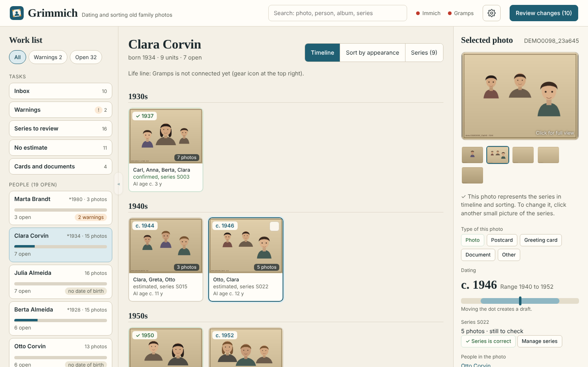
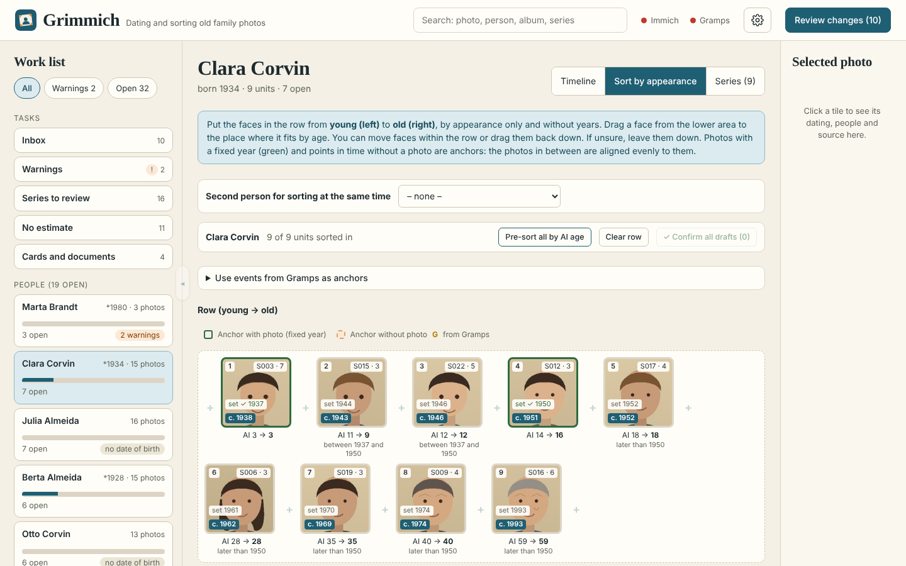
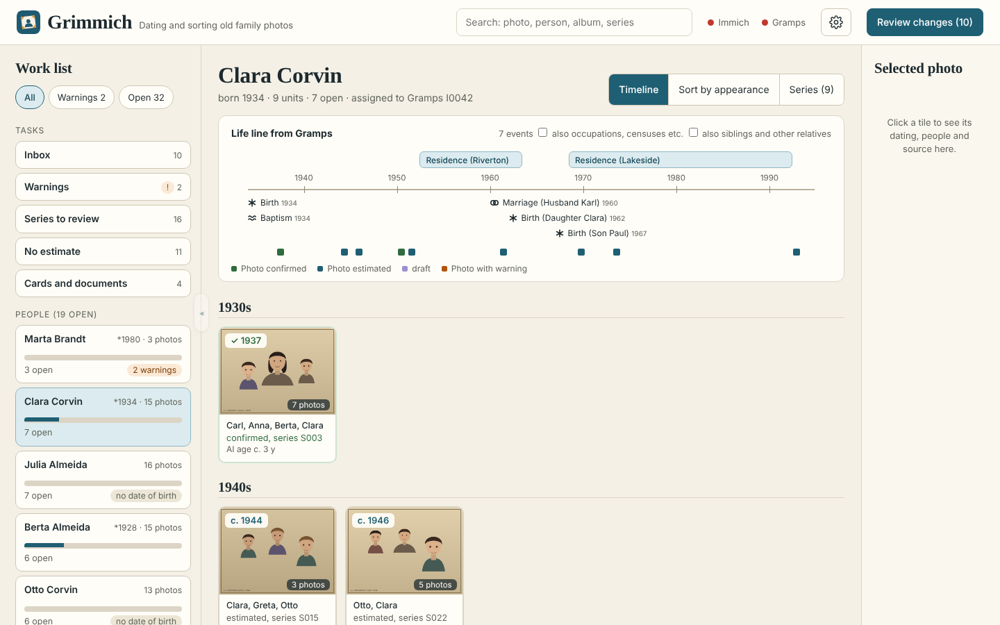
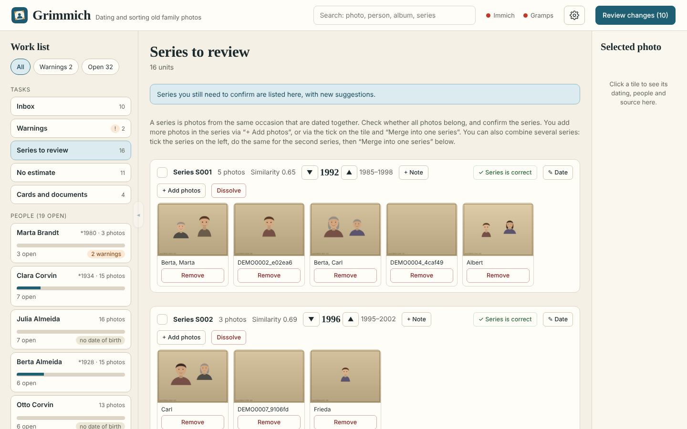
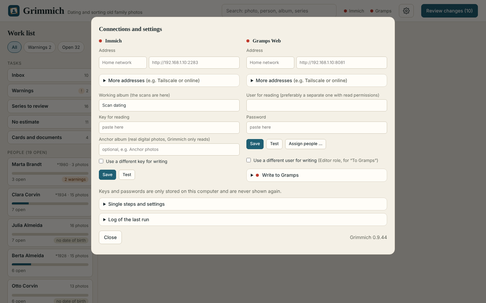

# Grimmich

**English** · [Deutsch](README.de.md)

Grimmich dates scanned old family photos. It reads photos and faces from [Immich](https://immich.app), estimates the
age of recognised people with an AI model, combines that with life dates from [Gramps Web](https://gramps-project.org)
to a year of the photo, groups related photos into series and writes the result back (capture date and tags in Immich;
photos, sources and events in Gramps). Everything runs on your own machine. Nothing is written to Immich or Gramps
unless you explicitly confirm it in the interface (preview, test with 3 photos, then all). The original values are
backed up before every change.

> **Note:** Grimmich is in active development and has no login yet. Anyone who can reach its port can read and change your data and, with write access set up, your Immich and Gramps. Run it only at home or inside a private network (for example Tailscale), never open its port to the internet.

## Screenshots

All screenshots show the invented demo data (see "Try it with invented data"), no real people or photos.

<table>
<tr><td width="50%" valign="top"> Work list on the left, the timeline of one person in the middle, the selected photo on the right.</td><td width="50%" valign="top"> Sort by appearance: put the faces of one person in a row from young to old; the photos in between are dated evenly.</td></tr>
<tr><td width="50%" valign="top"> Life line from Gramps: births, marriages and residences as anchors, with the photos below.</td><td width="50%" valign="top"> Series: photos from the same occasion are dated together.</td></tr>
<tr><td width="50%" valign="top"> Connections and settings.</td><td width="50%"></td></tr>
</table>

## Getting started

1. Python 3.10 or newer. In the Grimmich folder: `python3 -m venv .venv`
2. `./.venv/bin/pip install -r requirements.txt`
3. Enter your credentials in the interface under the gear icon.
4. `./.venv/bin/python grimmich.py`, then open <http://localhost:8765>. Stop with Ctrl+C.

Without a terminal (Linux): `bash launcher/install.sh` adds a "Grimmich" entry to the application menu. One click starts Grimmich in the background and opens the browser. To stop: right-click the entry, "Stop Grimmich".

Language: the interface is available in English and German. Grimmich follows the browser language; change it under the gear icon, "Single steps and settings", "Language".

To try something next to your normal Grimmich (e.g. a new version): unpack it into a second folder and start it with `GRIMMICH_PORT=8766 GRIMMICH_READ_ONLY=1 ./.venv/bin/python grimmich.py`. The second port lets both run at the same time, and `GRIMMICH_READ_ONLY=1` stops the second one from writing to Immich and Gramps.

## Try it with invented data

No photos, Immich or Gramps at hand? `demo_data.py` makes up a small data set (26 people, 140 drawn photos, 24 series, estimates):

1. Make a copy of the Grimmich folder (without `grimmich.db` and `*.env`).
2. In the copy: `python3 demo_data.py demo` and copy the content of the folder `demo` into the copy (`cp -r demo/. .`).
3. Start it there with `GRIMMICH_READ_ONLY=1 ./.venv/bin/python grimmich.py` and open <http://localhost:8765>.

Everything is invented and the same every time. Nothing can be written to Immich or Gramps (there is none behind it).

## Updating

If you installed Grimmich from the repository (`git clone`), update with two commands in the Grimmich folder: stop Grimmich, then `git pull`. Your data (`grimmich.db`, `*.env`, caches) is not part of the repository and stays untouched. If you installed from a ZIP file, unpack the new version over the old folder; the data stays as well.

## Docker

Grimmich also runs as a Docker container (for example on a home server next to Immich). The program is in the image, all your data (database, access files, AI models) lives in a folder you choose (`./data` by default, set in `docker-compose.yml`).

1. Get the repository on the server (`git clone`).
2. In `docker-compose.yml`, change `./data` to a folder on a large disk if you like (the AI models need a few GB).
3. `docker compose up -d --build` (the first build takes a while and downloads a few GB).
4. Open `http://<address of the server>:8765`.

To copy your existing data, put `grimmich.db` and the `*.env` files into the data folder before the first start. Settings: `GRIMMICH_LANGUAGE` (en or de), `GRIMMICH_READ_ONLY=1` (nothing is written to Immich or Gramps). Grimmich has no login yet: do not make the port reachable from the internet.

## Where is the data?

- `grimmich.db`: all working data (one SQLite file). **This is the file to back up** (copy it while Grimmich is stopped).
- `*.env`: credentials. Never share these files.
- `python3 storage.py export` writes all data as readable `.json` files into the folder `export`.
- An older installation with German names (database and `*.env` files) is switched to English names once on first start. Copies are kept first: `grimmich.db.vor-englisch` and `*.env.vor-englisch`. Check with `python3 migration.py report`.
- `python3 anonymize.py` creates an anonymised copy of the data for debugging and tests.

## Tests

`./.venv/bin/python -m unittest discover -s tests -v`

## Credits

Grimmich was designed and tested by dunjii and written together with [Claude](https://claude.ai) (Anthropic's AI assistant). Claude wrote most of the code in conversation with dunjii, who decided what Grimmich should do, tried every version on a real family photo collection and corrected it. Commits written with Claude carry a `Co-Authored-By: Claude` line.

## License

Grimmich is licensed under the **GNU Affero General Public License, version 3 (AGPL-3.0)**. Copyright 2026 dunjii
(<https://github.com/dunjii>). The full license text is in the file `LICENSE` in the repository.

Why AGPL-3.0: face and person detection runs through Ultralytics YOLO (AGPL-3.0). Using the same license for Grimmich
avoids any conflict. Anyone may use, change and share Grimmich freely, including commercially. Changes must be released
under the same license, even if the software is only offered over a network.

### Models used and their licenses

The models are not part of Grimmich. They are downloaded from Hugging Face on first start and are not stored in the project.

| Component | Purpose | License |
|---|---|---|
| [MiVOLO v2](https://huggingface.co/iitolstykh/mivolo_v2) (code and model) | age estimation | Apache-2.0 |
| [YOLO Face & Person Detector](https://huggingface.co/iitolstykh/YOLO-Face-Person-Detector) with [Ultralytics](https://www.ultralytics.com) | finding faces and people | AGPL-3.0 |
| [DINOv2 small](https://huggingface.co/facebook/dinov2-small) | image comparison for series | Apache-2.0 |

As checked on 1 Nov 2026 (statements on the model pages). This is not legal advice. If you redistribute Grimmich,
please check the model licenses yourself again.

## Adding a language

The texts in the code are English. Every other language is one file in the folder `languages/`:

1. Copy `languages/en.json` to `languages/<code>.json` (for example `fr.json`).
2. Set `language.code`, `language.name` (shown in the language switch) and `language.date_input` (`dmy` for 24.12.1935, `iso` for 1935-12-24).
3. Fill `texts` with `"English text": "translated text"`. Placeholders such as `{name}` and plurals such as `{n:photo|photos}` must stay the same. `languages/de.json` is a complete example.
4. Restart Grimmich. The language appears in the switch automatically. Texts you did not translate stay English. Set `"complete": false` in `language` while the file is unfinished.

`python3 -m unittest tests.test_language` checks every language file.

What Grimmich writes into Immich: the tags (estimated, open, and the kinds postcard / greeting card / document / other) and one short block in the description, for example `[GRM] ~1960 (1952–1968) · S038 [/GRM]`. In the block, `~` means estimated (no `~`: a fixed date), `?` means open, `S038` is the series (search for it in Immich to find the photos that belong together), and, if you switch it on, the source (photo album, page, photo) follows. The block marker `[GRM]` is the same in every language. The tag names are chosen once, when you first write, and then stay, so photos can be found again after switching the language. An installation that has written before keeps the German names; a new installation takes the names of its language. A language file can set its own names in a section `written` (keys `tag_estimated`, `tag_open`, `tag_postcard`, `tag_greeting_card`, `tag_document`, `tag_other`); without it English applies. Reading recognises the names of all languages, and the blocks of earlier versions (`[Grimmich]`, `[Datierung automatisch]`, `[Quelle]`) are replaced by the new block the next time a photo is written.

